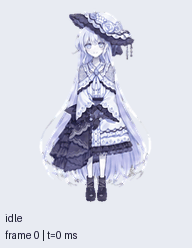

# 月代雪 · Codex 自定义宠物 v1.1.0

保留小脸、窄下颌与修长比例的月代雪动画宠物。相比 v1.0.0，站立角色可见高度由约161px增至192px，增加约19%。九种行为全部重做，以较克制的表情、视线和手势表达状态。

## 下载与使用

- [最终透明图集](assets/tsukishiro-yuki-v2.png)
- [v1.1.0 发布与完整 ZIP](https://github.com/ironsnake-change/tsukishiro-yuki-codex-pet/releases/tag/v1.1.0)
- [动作视频](previews/all-states.mp4) · [全部帧](previews/contact-sheet.png) · [16方向](previews/look-directions.png)

将PNG交给支持v2图集的Codex / ChatGPT Work Pets导入工作流即可使用。PNG是宠物素材，并非独立应用。v1.0.0在历史标签和旧Release中保留。

## 动作设计

| 状态槽位 | 帧数 | 新动作 |
| --- | ---: | --- |
| idle | 6 | 安静呼吸、自然眨眼 |
| running-right | 8 | 向右克制小步行走、发丝与裙摆跟随 |
| running-left | 8 | 独立绘制向左行走，保留非对称服装 |
| waving | 4 | 胸前抬掌、轻摆手腕问候 |
| jumping | 5 | 原地歪头、闭眼浅笑、小幅点头；全程不跳 |
| failed | 8 | 短暂蹙眉、垂眼或移开视线，再恢复平静 |
| waiting | 6 | 指尖靠近脸颊，轻歪头等待回应 |
| running | 6 | 低头思考、手靠近下巴、专注观察 |
| review | 6 | 向下检查、食指示意、轻点头确认 |
| look | 16 | 身体保持正面，以头部与眼神表达方向 |

动作参考《魔法少女的魔女审判》月代雪的静态姿势与神态，再设计为宠物循环；不是游戏官方动画的逐帧复刻。[社区立绘参考出处](https://github.com/entropy622/Text_box-of-mahoushoujo_no_majosaiban/tree/3962f1f6185e0710f615e2a051635d33454d9504/yuki)。本仓库不附原始参考图。

## 格式、验证与限制

图集为1536×2288 RGBA PNG；8列11行，每格192×208；73个有效帧，15个空格透明。单帧尺寸没有增大，增加的是画面内角色的占比，客户端仍决定实际屏幕大小。

最终字节已通过本地v2结构、透明区、边缘、配准、自定义动作质量检查及Pets平台预检。四个主方向的独立盲检通过。斜向的细微眼神和俯仰在小尺寸下仍有歧义；157.5°→180°、337.5°→0°的头部过渡有差异警告，已保留在报告中。

**jumping槽位是用户指定的原地致意。** 默认检查因离地高度为0px而失败，唯一失败项是默认要求至少8px离地。自定义检查仅设置 --minimum-jump-lift 0，其余检查不变并通过；五帧脚底基线均为202px。它不应被描述为通过了默认跳跃检查。

- [自定义质量报告](qa/pet-quality-custom-row4.json) · [默认检查原始结果](qa/pet-quality-default.json)
- [盲检报告](qa/blind-validation.json) · [方向语义](qa/direction-semantics.json) · [视觉复核](qa/final-labelled-review.json)

SHA-256：9654ebd87a823fd34e5030afaca921a3ec5497e39c9d4814c11aafd61bfce176

## 制作与权利说明

使用gpt-image-2.5结合角色参考图重新绘制，经透明背景清理、统一缩放配准、逐帧提取和图集组装。细节受192×208单帧分辨率限制，AI重绘仍不能保证与原画完全一致。

非官方角色衍生素材；原角色及参考作品的权利归其权利人所有。未对原角色或整体素材声明开源授权，亦未附加未经确认的商业使用许可。
